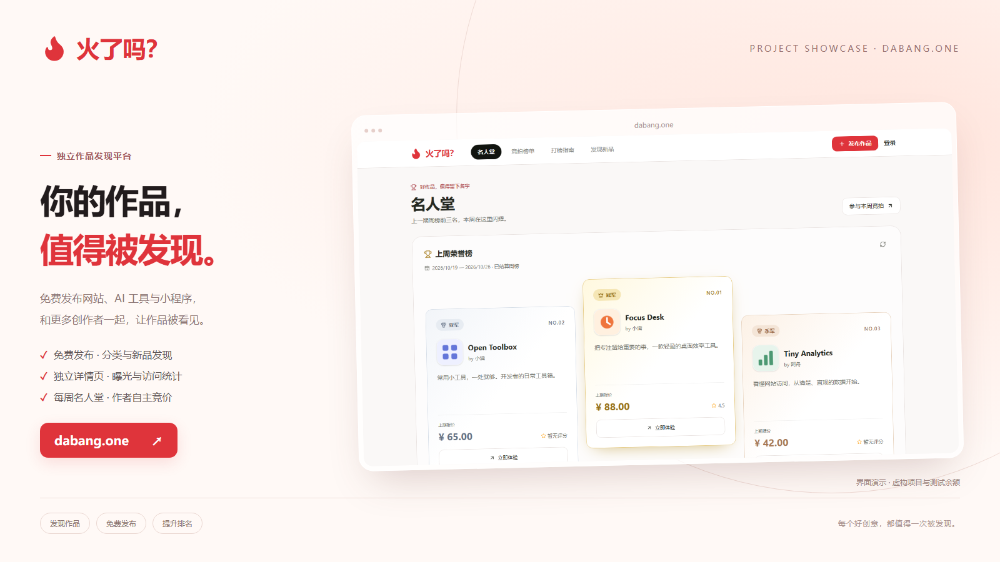
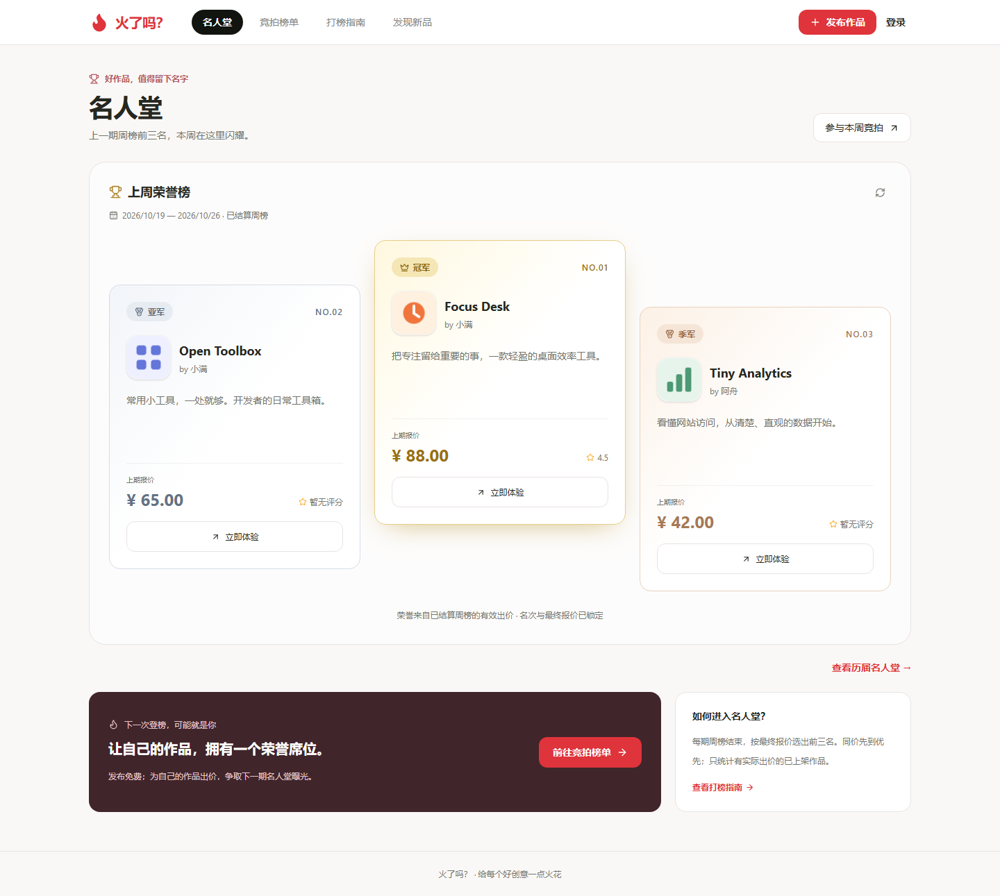
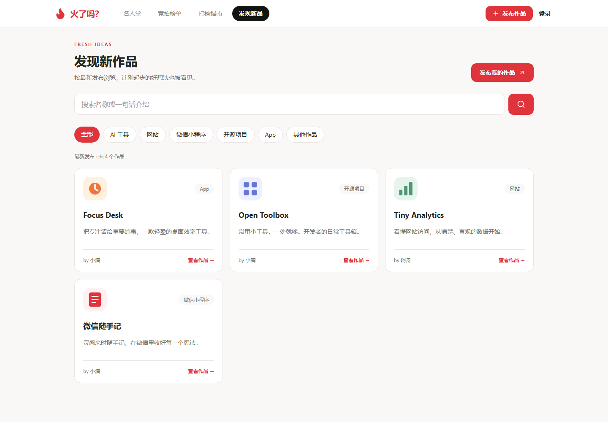
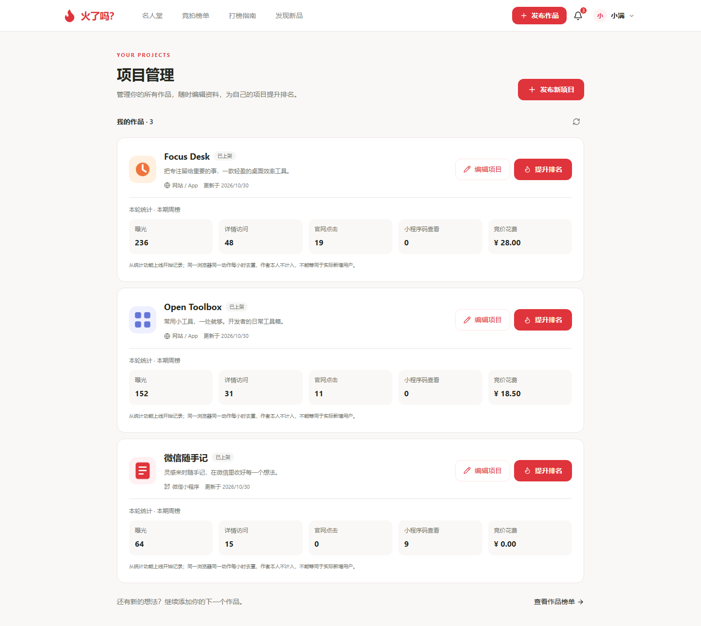
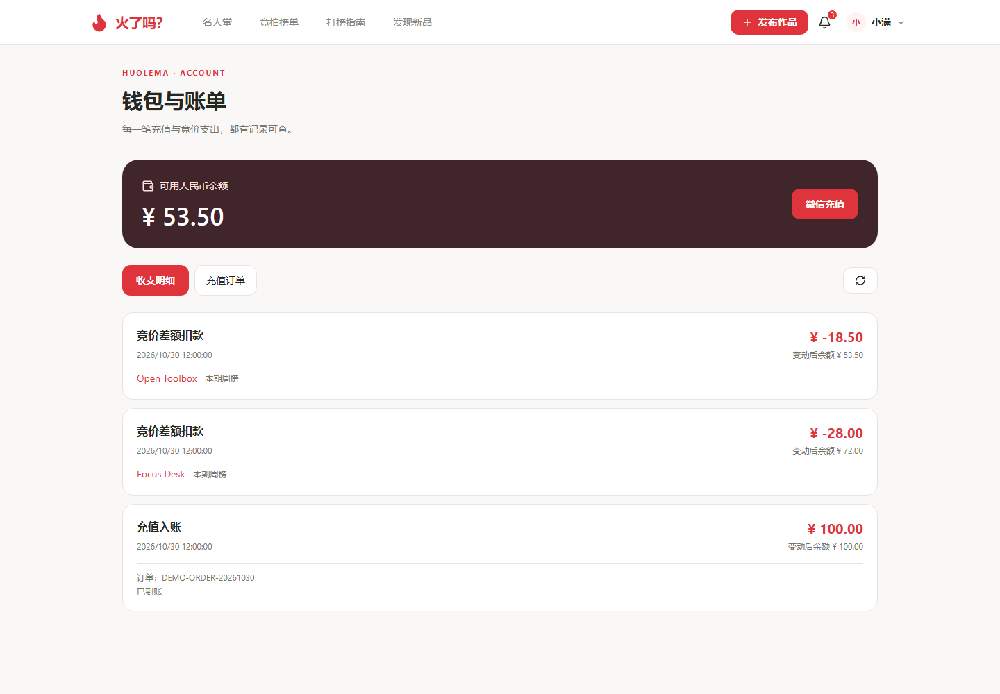
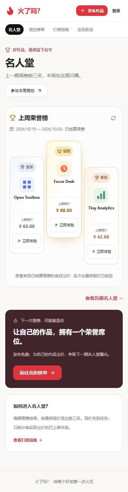
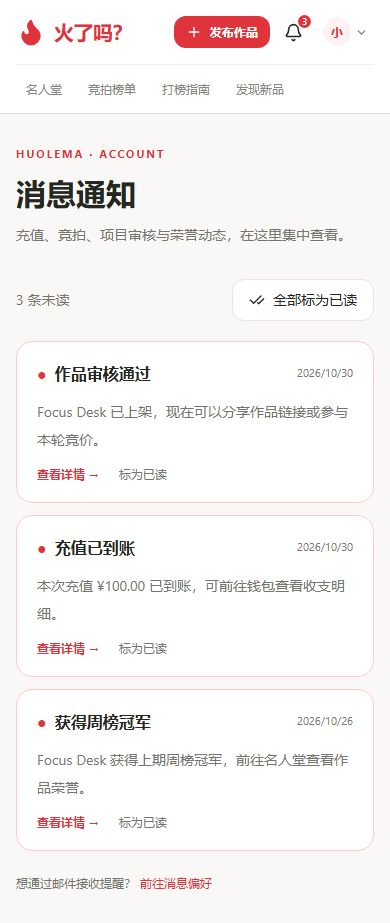

  <strong>做了网站、AI 工具或微信小程序？给你的作品一个被发现的入口。</strong> 
  免费发布 · 分类发现 · 独立详情页 · 每周名人堂

  <a href="https://dabang.one/discover"><strong>发现新作品</strong></a> ·
  <a href="https://dabang.one/projects/new"><strong>免费发布我的作品</strong></a> ·
  <a href="https://dabang.one">本期名人堂</a> ·
  <a href="docs/USER_GUIDE.md">使用教程</a> ·
  <a href="docs/SCREENSHOTS.md">界面展示</a> ·
  <a href="docs/FAQ.md">常见问题</a>

## 火了吗？是什么

**火了吗？** 是一个面向独立开发者、创作者和产品爱好者的项目发现与竞价展示平台。

你可以在这里发现网站、AI 工具和微信小程序，阅读介绍与评价，直接前往体验；也可以免费提交自己的作品，审核通过后获得可分享的独立详情页，持续更新资料并查看曝光统计。希望参与榜单展示的作者，还可以自主选择人民币竞价。每期周榜结算后，前三名会进入首页名人堂。

**发布与浏览无需充值，竞价是可选的展示方式。** 新作品也能在「发现新品」中按发布时间被找到。

如果你已经把产品做出来，却还缺一个介绍它的地方，欢迎把作品带来。

> 本仓库是火了吗？的**产品介绍与使用指南**，只包含宣传文档和展示图片。网站直接在线使用，无需下载或安装。本仓库不提供网站程序源码。

## 谁适合使用

| 你是…… | 可以在这里做什么 |
| --- | --- |
| 独立开发者、个人创作者 | 发布作品，介绍功能，维护项目资料，参与竞价展示 |
| 小程序开发者 | 上传小程序码，提供分享口令或微信 URL Link，让访客找到体验入口 |
| 产品爱好者、工具使用者 | 发现项目，访问官网，查看或分享使用感受 |
| 拥有多个作品的创作者 | 在同一个账号下集中管理作品，分别编辑和出价 |

## 从发现到发布

### 发现作品：从名人堂和榜单开始

首页展示**上期已结算周榜的前三名**。冠军位于中间，亚军和季军分列两侧；进入竞拍榜单，还可以浏览本轮项目、搜索名称或简介。

访客点击 **「立即体验」**，网站项目会打开官网，小程序项目会展示码图与打开入口。点击项目名称进入独立详情页，查看介绍、评价和历史荣誉，并复制网址分享。

[发现新品](https://dabang.one/discover) 支持 AI 工具、网站、微信小程序、开源项目、App 与其他作品分类，可以搜索并按最新发布浏览；[历届名人堂](https://dabang.one/hall/history) 则可以按已结算周榜回看前三名与最终报价。

### 发布作品：给产品一个介绍自己的位置

发布免费。填写名称、分类、官网或小程序入口，补充图标、介绍和 App 链接，提交审核后即可等待上架。只有微信小程序的项目需要上传小程序码。

发布后仍可继续编辑；同一账号可以发布多个项目。**新提交和修改后的项目都需要审核，审核期间暂不公开**，已有报价、评价与历史荣誉保留。审核结果会通过站内消息通知。

### 提升排名：由项目作者自主出价

项目作者会看到 **「提升排名」**，其他用户看到 **「立即体验」**。作者可以从榜单、名人堂或项目管理进入出价弹窗，查看本轮报价、钱包余额和实际补付差额。

例如：本轮报价从 **¥10.00 提高到 ¥15.00，只需再支付 ¥5.00**。

### 收获反馈：让使用者留下感受

用户登录后可对项目提交 **1–5 星评分与文字评价**。每人对同一项目保留一条评价，并可修改。评价帮助大家了解作品，不改变竞价排名。

不当评价可通过「举报」反馈。创作者在项目管理中还能查看本轮曝光、详情访问、官网点击、小程序码查看及竞价花费，了解作品被发现的情况。

## 界面预览

以下图片来自产品界面，使用**虚构项目、演示评价、演示统计与测试余额**；不代表真实用户、真实交易或实际推广效果。小程序示意图不具有真实跳转功能。

**首页名人堂**

**发现新品 · 按分类与最新发布找到作品**

**创作者项目管理**

**钱包与账单 · 充值与竞价支出都有记录**

<table>
  <tr>
    <td align="center"><strong>手机名人堂</strong></td>
    <td align="center"><strong>站内消息</strong></td>
  </tr>
  <tr>
    <td align="center"></td>
    <td align="center"></td>
  </tr>
</table>

独立详情页、历届名人堂、发布表单、出价弹窗、小程序展示与账号安全，见 **[完整界面图集](docs/SCREENSHOTS.md)**。

## 三分钟开始使用

| 你想做什么 | 从哪里开始 |
| --- | --- |
| 找一个好用的项目 | 打开 [发现新品](https://dabang.one/discover) 选择分类或搜索，或从 [名人堂](https://dabang.one) 进入 |
| 发布自己的作品 | 点击 [发布作品](https://dabang.one/projects/new)，注册或登录后填写资料并提交审核 |
| 修改已发布的项目 | 右上角用户管理 → 项目管理 → 编辑项目 |
| 为自己的项目出价 | 项目管理 → 提升排名 → 确认新的总报价和实际扣款 |
| 给项目写评价 | 点击项目名称 → 登录 → 选择星级并填写使用感受 |
| 看作品曝光情况 | [项目管理](https://dabang.one/projects) → 每个作品下方的本轮统计 |
| 查充值和支出 | [钱包与账单](https://dabang.one/wallet) → 收支明细 / 充值订单 |
| 找回账号密码 | 登录弹窗「忘记密码」，或打开 [密码找回](https://dabang.one/forgot-password) |

注册需要邮箱验证码和密码；后续使用邮箱与密码登录。新账号余额为零，**发布项目无需先充值**。

完整步骤与配图见 **[用户使用教程](docs/USER_GUIDE.md)**。

## 竞价和充值规则

| 项目 | 当前规则 |
| --- | --- |
| 谁能出价 | 仅项目作者可以为自己的已上架项目出价 |
| 排名依据 | 本轮总报价从高到低排序；同价时先达到该报价的项目优先 |
| 如何扣款 | 只扣新旧报价的差额，提交成功后立即扣除 |
| 竞拍周期 | 每 7 天一期，以网站当前显示的起止时间为准 |
| 周期结束 | 上期前三名进入名人堂；新一期报价从零开始 |
| 已使用费用 | 不因被超越或周期结束自动退回；未使用的钱包余额保留 |
| 充值方式 | 微信支付 |
| 充值档位 | ¥20、¥50、¥100、¥200、¥500、¥1000 |
| 用户评价 | 用于分享使用感受，不影响竞价排名 |

竞价排名反映项目作者的付费展示选择，不等同于用户评分或平台对产品质量的评定。靠前的展示位置不承诺固定访问量、用户数或成交结果。

详细规则见网站 [打榜指南](https://dabang.one/guide) 和本仓库 [常见问题](docs/FAQ.md)。

## 已上线的功能

| 方向 | 已有能力 |
| --- | --- |
| 发布与管理 | 多项目、编辑、分类、图标、小程序码、App 入口、审核状态 |
| 发现与展示 | 最新发布、分类搜索、独立详情页、星级文字评价、电脑与手机适配 |
| 榜单与荣誉 | 作者竞价、差额扣款、本期排行、上期前三、历届名人堂、历史徽章 |
| 钱包 | 微信充值、收支明细、充值订单、余额、未到账反馈 |
| 作者统计 | 本轮曝光、详情访问、官网点击、小程序码查看、竞价花费 |
| 账号与提醒 | 邮箱验证注册、密码找回与修改、退出其他设备、站内消息、可选邮件提醒 |
| 平台管理 | 项目审核及下架恢复、评价举报处理、违规账号处理、订单与本站账务核查、操作记录 |

邮件提醒默认关闭，可在「账号安全」中开启。曝光统计从功能上线开始记录，不等于精确访客数或推广收益。管理后台仅向管理员开放；本站账务核查不等于支付平台主动查单。当前没有自助退款或提现入口。

## 反馈与关注

欢迎通过本仓库的 **[Issues](https://github.com/wlk666888/huolema/issues)** 提交使用问题和功能建议。描述页面、操作步骤与期望结果即可；个人订单问题请使用站内钱包反馈，公开反馈中请勿填写密码、邮箱验证码、支付凭据或个人订单信息。

如果这个平台适合你，欢迎 **Star 收藏本仓库**，也欢迎把网站分享给正在做产品的朋友。

**[现在去发现项目 →](https://dabang.one/discover)**　**[免费发布我的作品 →](https://dabang.one/projects/new)**

## About Huolema

Huolema is a Chinese-language discovery platform for indie products, AI tools, websites and WeChat mini programs. Creators can submit projects for free, share dedicated product pages, collect reviews and view engagement statistics. Optional owner-funded bidding determines the weekly leaderboard and Hall of Fame. This repository contains the product showcase and user documentation; application source code is not included.

---

本仓库为产品展示仓库，未对网站业务代码作开源授权。文档与截图对应 2026 年 10 月 30 日的产品界面，实际功能、周期与支付状态以网站为准。
