# 界面展示

[返回项目介绍](../README.md) · [使用教程](USER_GUIDE.md) · [访问网站](https://dabang.one)

以下截图来自当前产品界面，全部使用虚构项目、演示评价和测试余额。小程序码区域为无实际跳转的示意图，图片不代表真实用户或推广效果。

## 首页名人堂

上期前三名采用领奖台布局；访客可以直接体验项目。

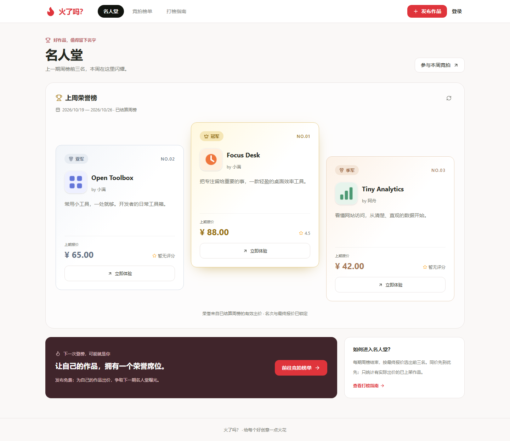

## 竞拍榜单

展示本轮报价、作品介绍和访问入口，支持搜索与本人作品筛选。

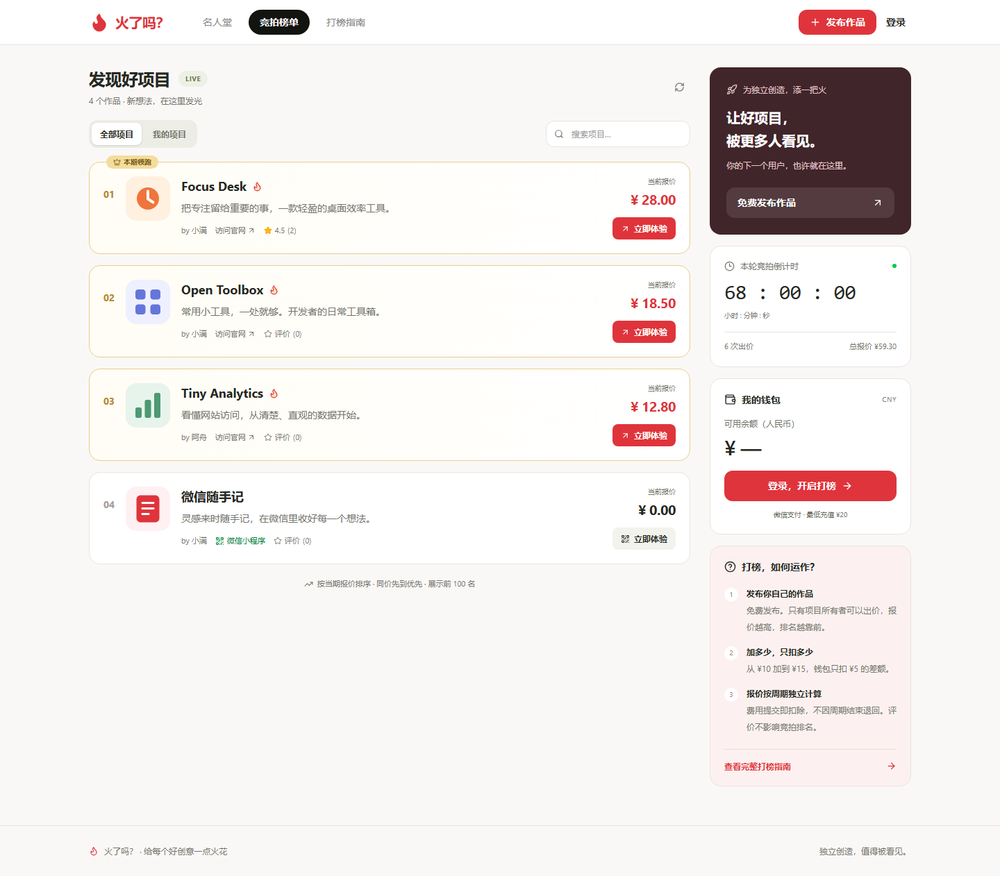

## 项目管理

一个账号管理多个作品，每个项目都有编辑和提升排名入口。

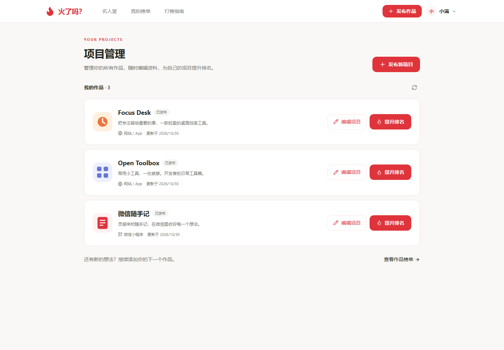

## 发布小程序

选择小程序入口，填写介绍并上传码图。截图展示填写中的表单。

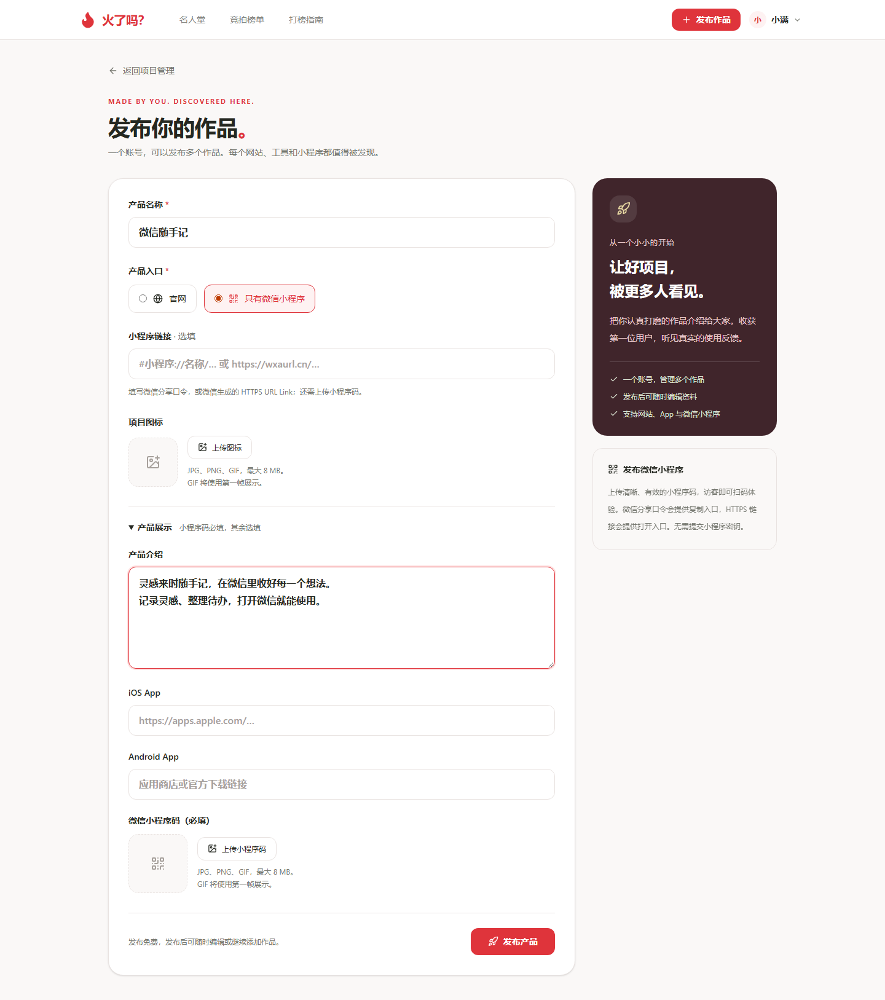

## 编辑已发布项目

继续完善名称、介绍、图标和访问入口。

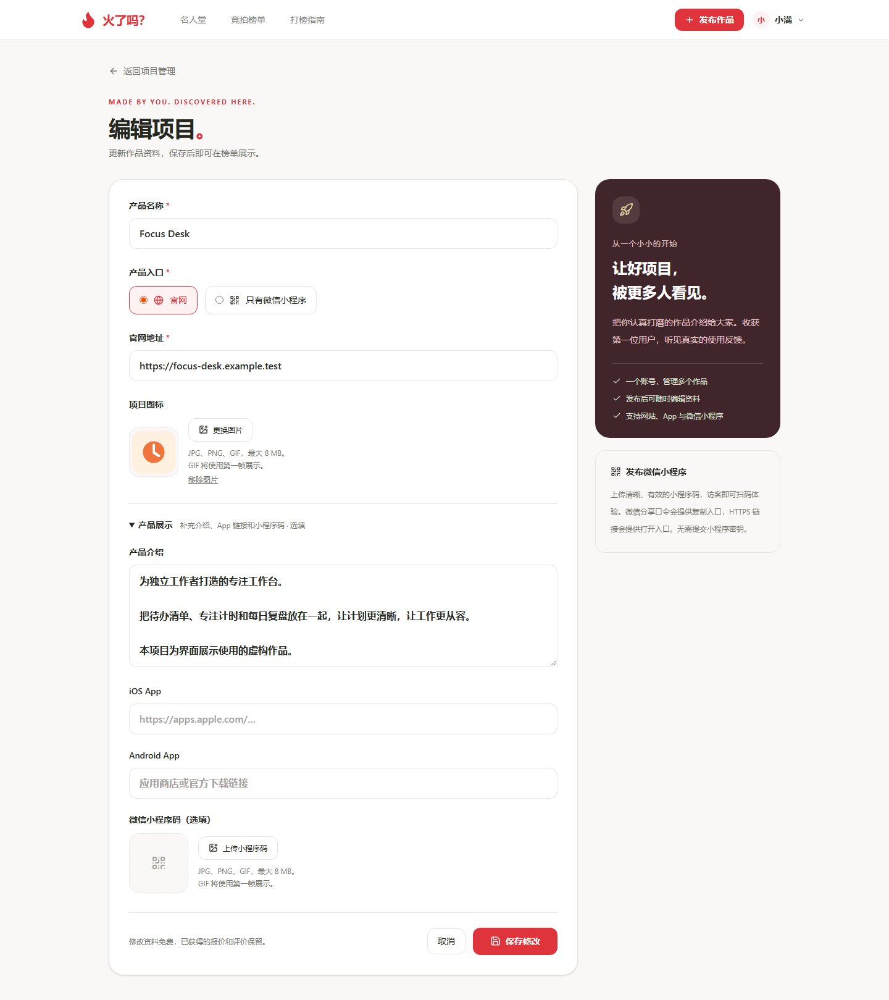

## 提升排名

查看当前报价、新的总报价、钱包余额和本次实际扣款，再确认出价。

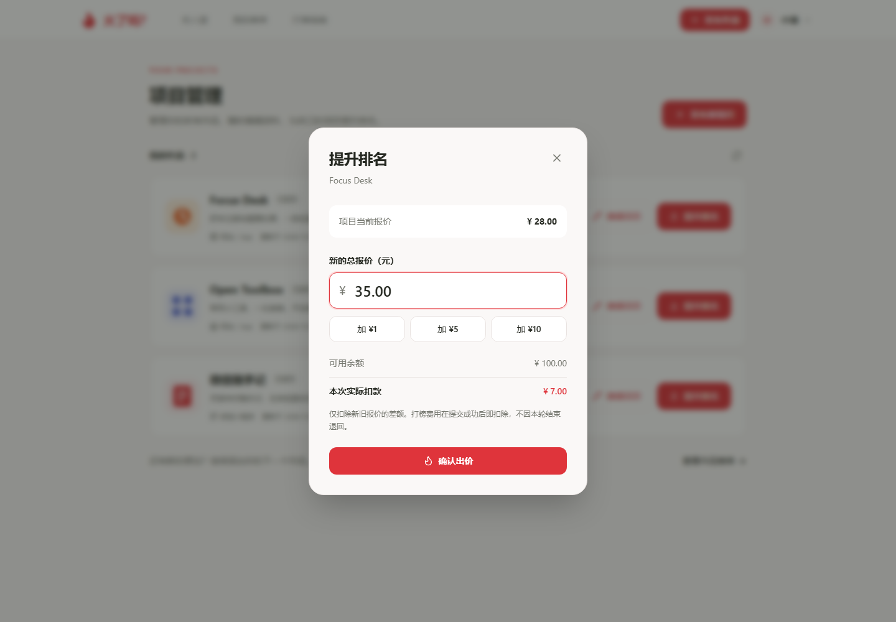

## 钱包充值

六个人民币充值档位，通过微信支付充值。

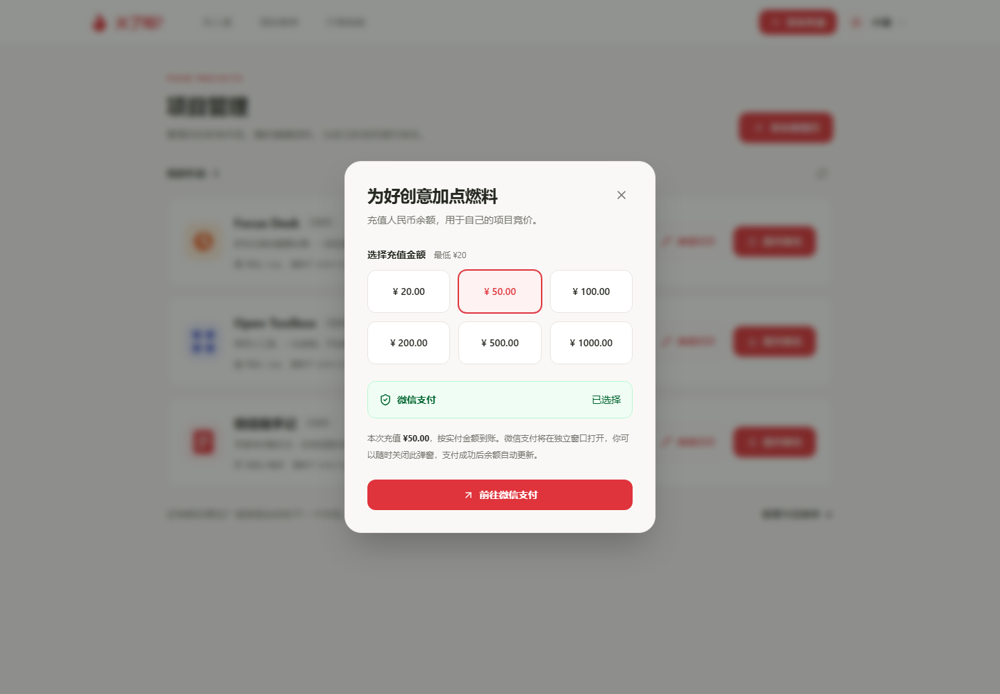

## 项目介绍与评价

阅读项目介绍、找到官网入口，并查看使用者的星级和文字反馈。

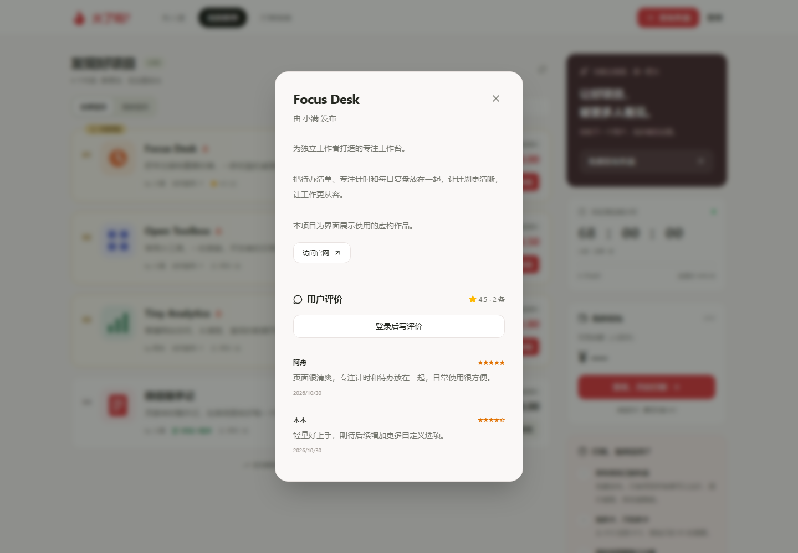

## 打榜指南

在网站内了解发布、充值、差额扣款和周期结算规则。

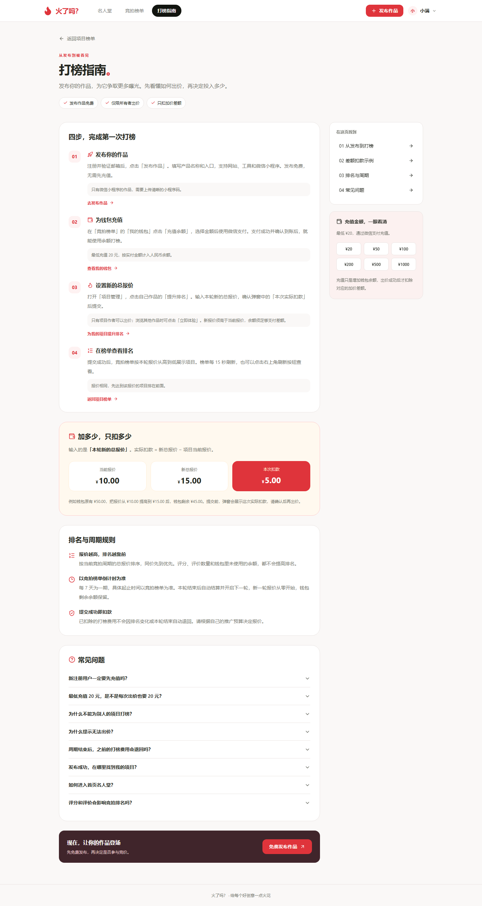

## 手机端

<table>
  <tr><td align="center"><strong>名人堂</strong></td><td align="center"><strong>竞拍榜单</strong></td></tr>
  <tr>
    <td align="center">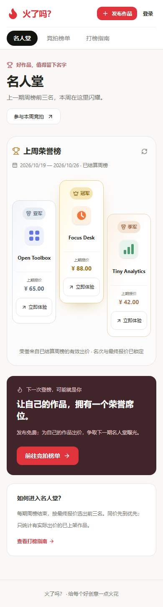</td>
    <td align="center">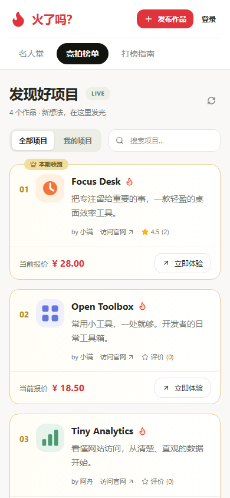</td>
  </tr>
  <tr><td align="center"><strong>项目管理</strong></td><td align="center"><strong>小程序展示</strong></td></tr>
  <tr>
    <td align="center">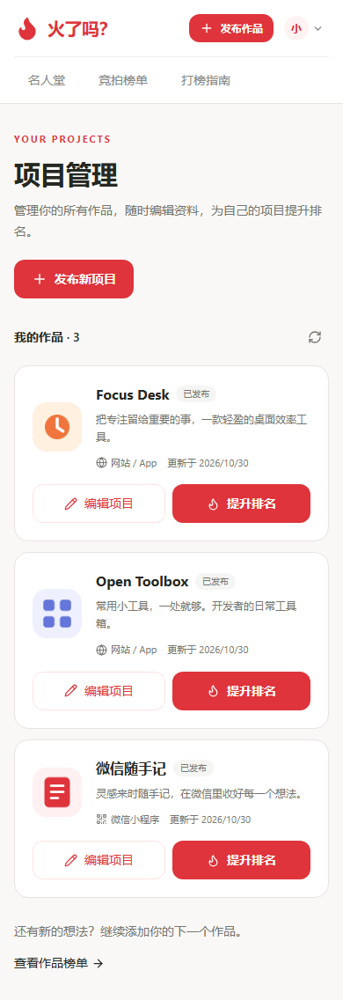</td>
    <td align="center">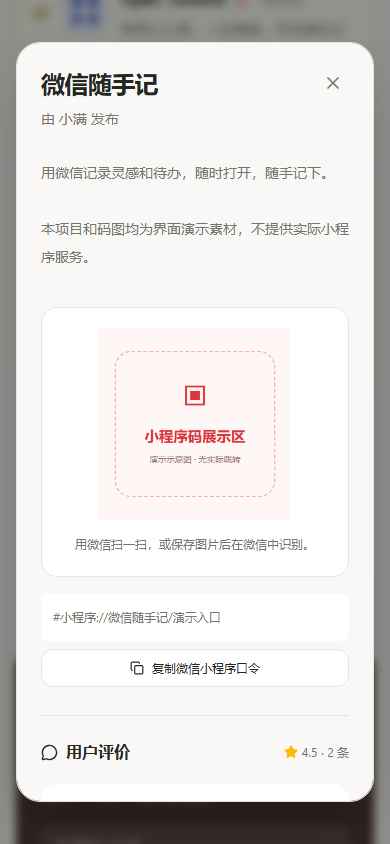</td>
  </tr>
</table>
