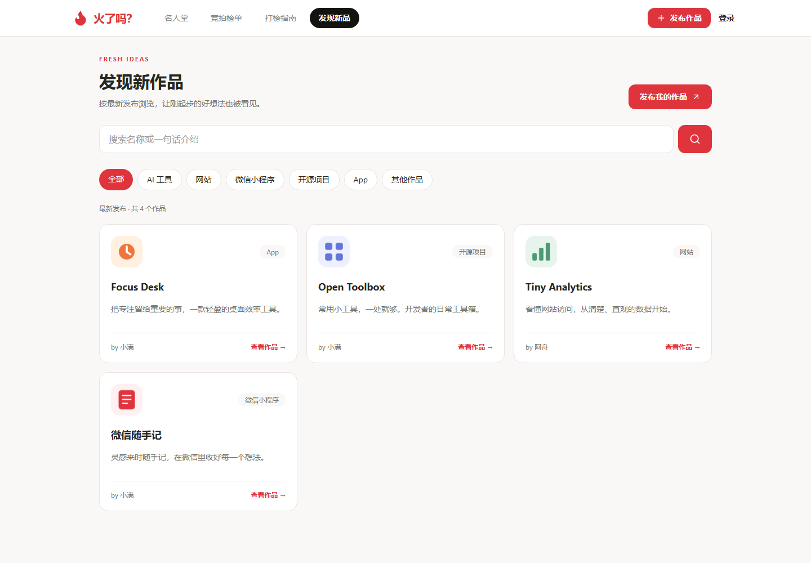
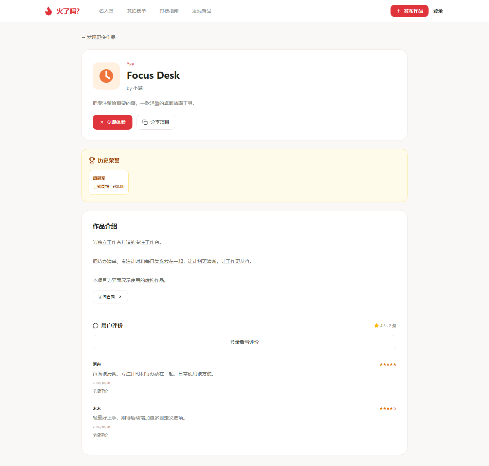
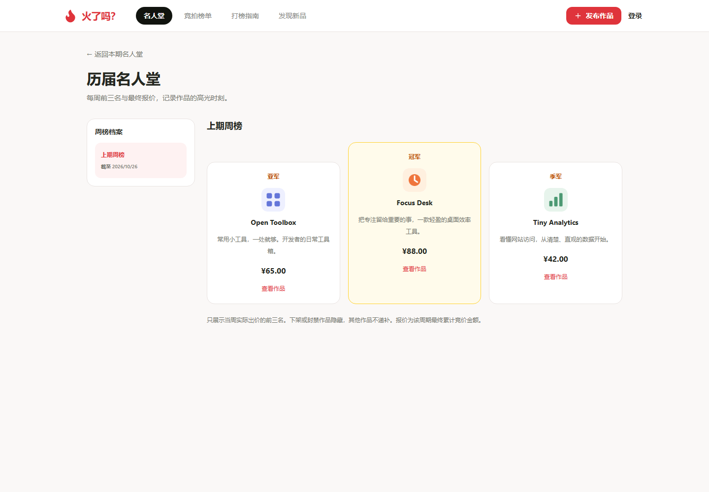
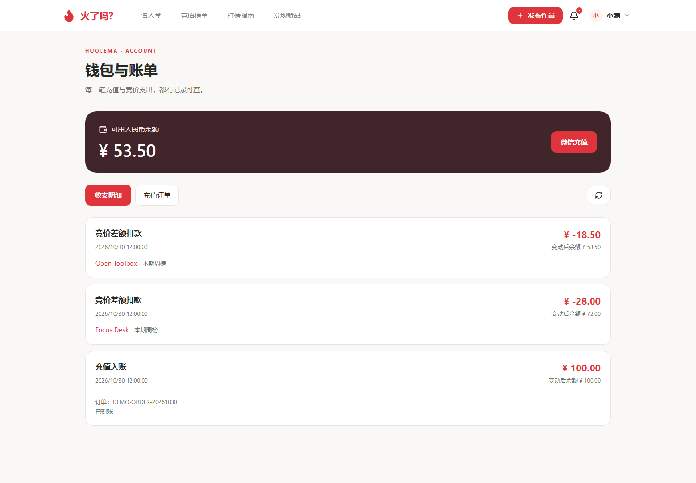
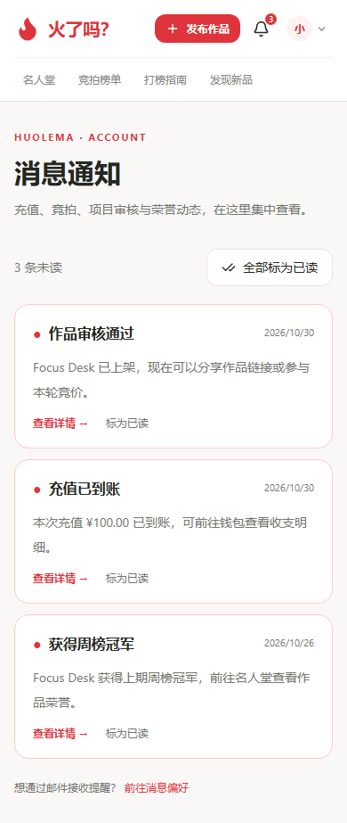
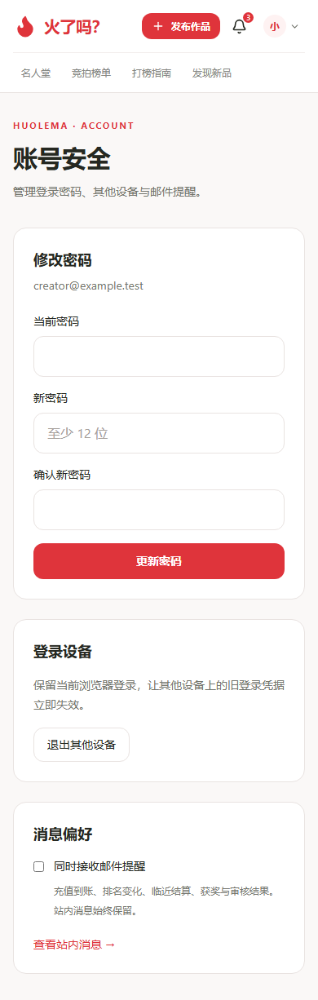

# 界面展示

[返回项目介绍](../README.md) · [使用教程](USER_GUIDE.md) · [访问网站](https://dabang.one)

以下截图来自产品界面，全部使用虚构项目、演示评价、演示统计和测试余额。小程序码区域为无实际跳转的示意图，图片不代表真实用户、交易或推广效果。截图更新于 2026 年 10 月 30 日。

## 首页名人堂

上期前三名采用领奖台布局；访客可以直接体验项目。

## 竞拍榜单

展示本轮报价、作品介绍和访问入口，支持搜索与本人作品筛选。

## 项目管理

一个账号管理多个作品，查看审核状态、编辑资料、为已上架项目提升排名；卡片下方集中展示本轮曝光、详情访问、官网点击、小程序码查看和竞价花费。

## 发现新品

按最新发布浏览，支持 AI 工具、网站、微信小程序、开源项目、App 等分类与关键词搜索。

## 独立项目详情页

一个可分享的网址，集中展示作品介绍、入口、评价与历史荣誉。

## 历届名人堂

选择已结算周榜，查看当周前三名和最终累计报价。

## 发布小程序

选择小程序入口，填写介绍并上传码图。截图展示填写中的表单。

## 编辑已发布项目

继续完善名称、分类、介绍、图标和访问入口。保存后重新提交审核，审核期间暂不公开。

## 提升排名

查看当前报价、新的总报价、钱包余额和本次实际扣款，再确认出价。

## 钱包充值

六个人民币充值档位，通过微信支付充值。

## 钱包与账单

查看人民币余额、充值入账、竞价差额扣款和变动后余额；充值订单提供支付未到账反馈入口。

## 项目介绍与评价

阅读项目介绍、找到官网入口，并查看使用者的星级和文字反馈。

## 打榜指南

在网站内了解发布、充值、差额扣款和周期结算规则。

## 手机端

<table>
  <tr><td align="center"><strong>名人堂</strong></td><td align="center"><strong>竞拍榜单</strong></td></tr>
  <tr>
    <td align="center"></td>
    <td align="center"></td>
  </tr>
  <tr><td align="center"><strong>项目管理</strong></td><td align="center"><strong>小程序展示</strong></td></tr>
  <tr>
    <td align="center"></td>
    <td align="center"></td>
  </tr>
</table>

## 消息通知与账号安全

站内消息集中展示审核、充值、排名和荣誉动态。账号安全提供密码修改、退出其他设备和邮件提醒偏好；登录弹窗还可进入邮件找回密码。

<table>
  <tr><td align="center"><strong>站内消息</strong></td><td align="center"><strong>账号安全</strong></td></tr>
  <tr>
    <td align="center"></td>
    <td align="center"></td>
  </tr>
</table>
