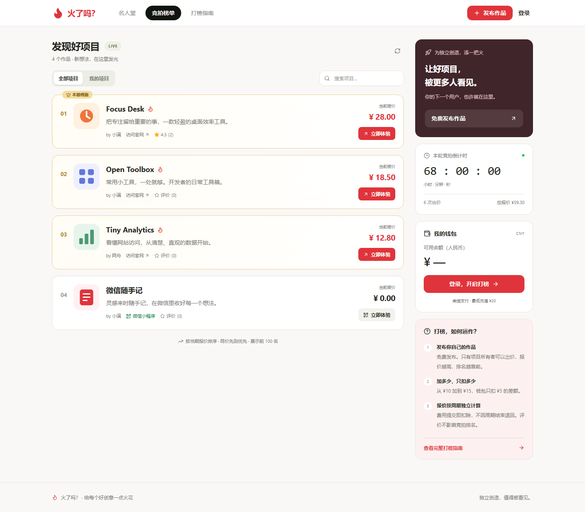
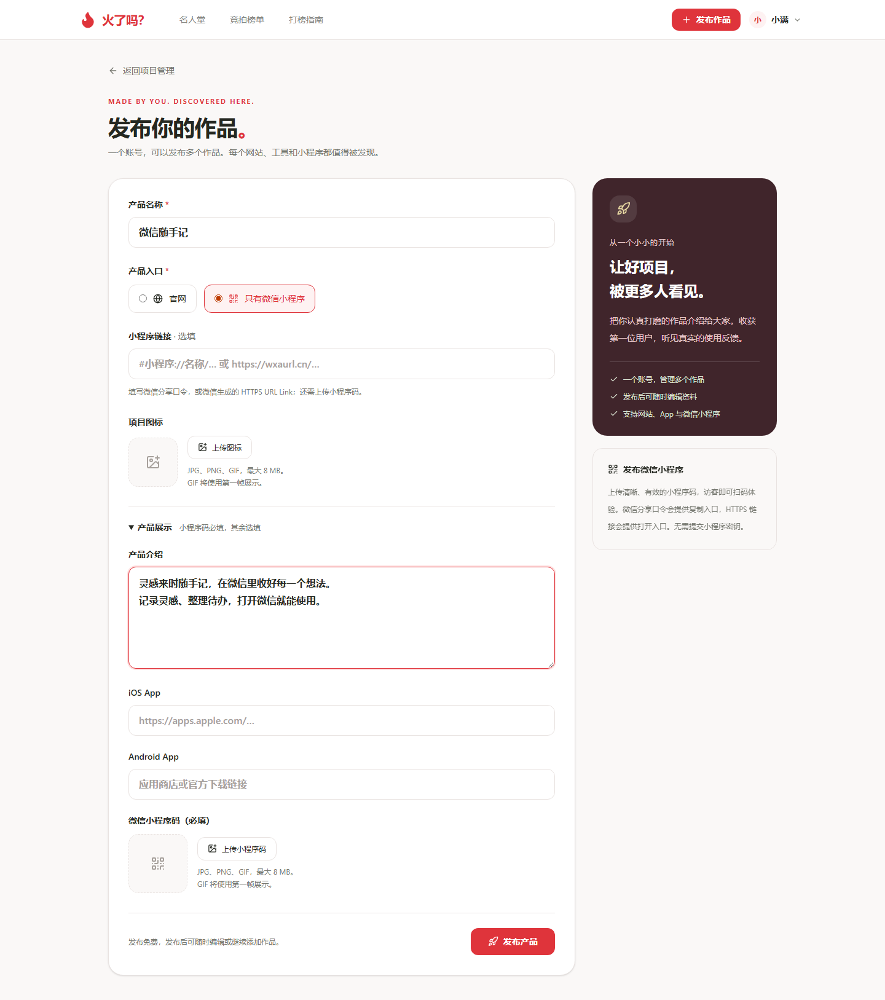
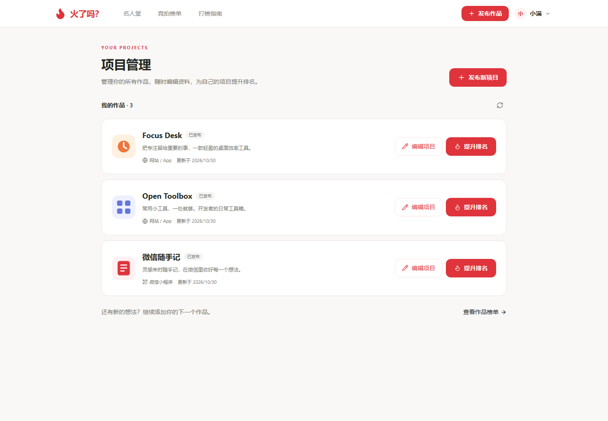
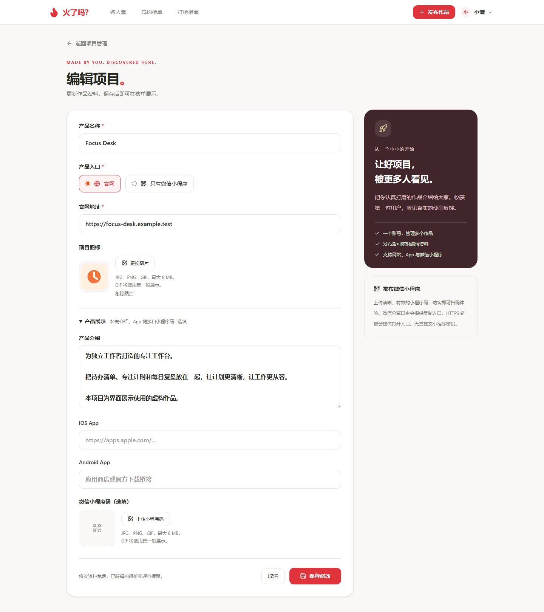
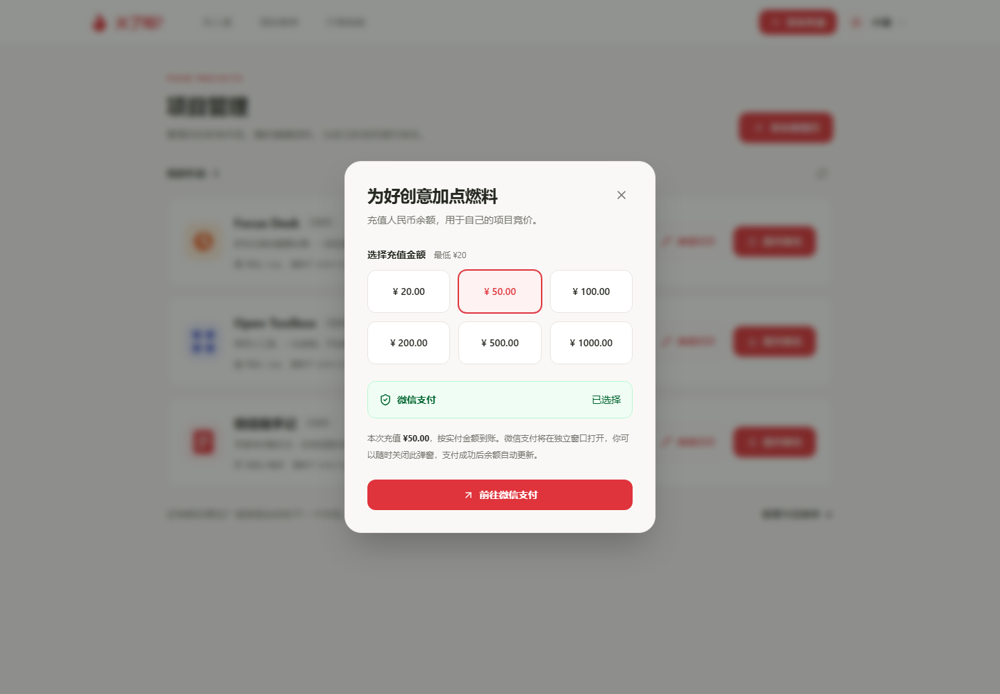
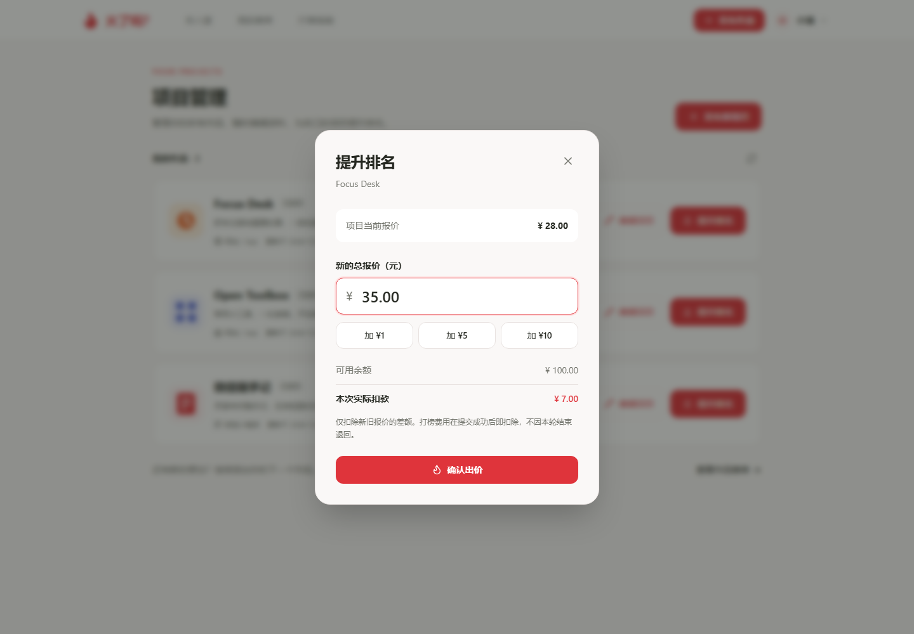
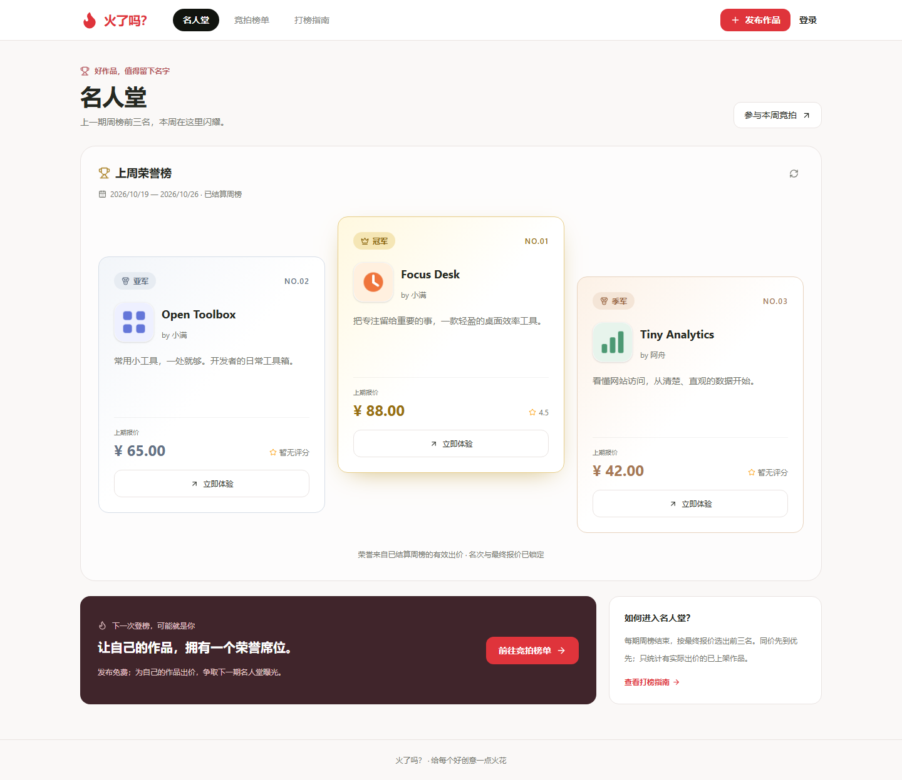
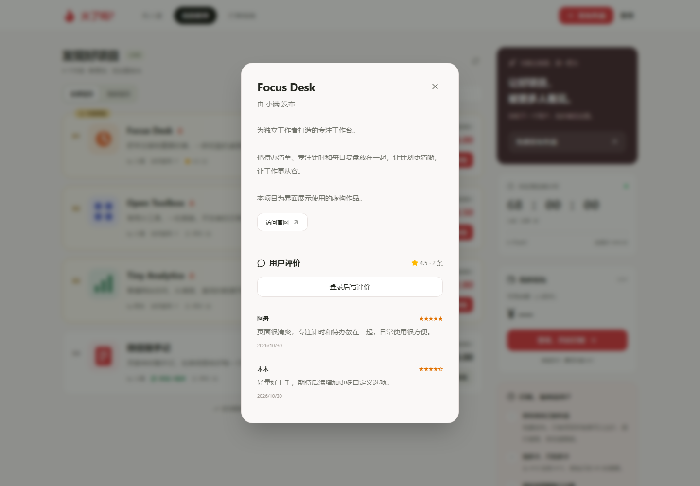

# 火了吗？使用教程

[返回项目介绍](../README.md) · [访问网站](https://dabang.one) · [常见问题](FAQ.md)

火了吗？直接在浏览器中使用。无需安装程序，也无需下载本仓库。

本教程中的截图使用虚构项目和测试余额，仅用于介绍操作流程。

## 1. 浏览和体验项目

打开网站后首先看到名人堂，其中展示上期已结算周榜的前三名。想看正在参与本轮竞拍的项目，点击顶部的「竞拍榜单」。

榜单按照本轮报价排序，可以通过搜索框查找项目名称或简介。公开榜单展示前 100 名；「我的项目」用于筛选自己的作品。

- **立即体验**：网站项目另开窗口访问官网；小程序项目打开码图和微信入口。
- **项目名称**：打开详细介绍、官网或 App 链接，以及用户评价。
- **星级／评价数量**：打开该项目的评价区域。

浏览和体验项目无需充值。访客不会看到为其他人的项目付费出价的按钮。

## 2. 注册与登录

1. 点击右上角「登录」，在弹窗中选择「立即注册」。
2. 填写自己的邮箱，点击发送验证码，到邮箱中查收。
3. 填写验证码、昵称、至少 12 位密码及确认密码，完成注册。
4. 后续登录使用邮箱和密码。邮箱验证码仅用于注册。

新账号余额为 **¥0.00**。注册后可以直接发布作品，不需要先充值。

验证码未收到时，先检查邮箱拼写、垃圾邮件和接收延迟。发送有冷却时间，请按页面提示重试。

## 3. 发布网站、工具或 App 入口

进入 [发布作品](https://dabang.one/projects/new)，选择「官网」作为产品入口。

| 字段 | 如何填写 |
| --- | --- |
| 产品名称 | 填写容易识别的名称，最多 100 字 |
| 官网地址 | 填写完整的 `https://` 或 `http://` 地址 |
| 项目图标 | 可选，上传 JPG、PNG 或 GIF，单张不超过 8 MB |
| 产品介绍 | 可选，说明服务对象、解决的问题和主要功能，最多 5000 字 |
| iOS App / Android App | 可选，填写应用商店或官方下载页面链接 |
| 微信小程序码 | 有对应小程序时可补充上传 |

检查资料后点击「发布产品」。成功后进入项目管理，可以继续编辑，或继续发布下一个项目。

平台展示的是作品资料和访问入口，不提供 App 安装包托管。

## 4. 发布微信小程序

1. 在发布页选择「只有微信小程序」。
2. 填写产品名称和介绍。
3. **上传清晰、有效的小程序码，这是必填项。**
4. 可补充微信分享口令，或微信生成的 HTTPS URL Link。
5. 点击「发布产品」。

当前支持 `#小程序://…` 分享口令，以及 `wxaurl.cn` / `wxmpurl.cn` 的 HTTPS 链接。请填写微信实际生成的内容，不要自行拼接。

访客可以查看码图、用微信识别；分享口令提供复制入口，支持的 HTTPS 链接提供打开入口。实际能否直接跳转，取决于微信、浏览器和链接有效期。

展示自己的小程序**不需要提供 AppSecret 或其他小程序密钥**。

## 5. 管理和编辑多个项目

右上角点击头像或昵称，选择「项目管理」。

- 点击 **发布新项目**，为同一个账号添加另一件作品。
- 点击某个项目的 **编辑项目**，修改名称、介绍、入口、图标或小程序码。
- 点击 **提升排名**，为这个项目参与当前周期竞价。

每个项目单独管理、单独出价。修改项目资料不会清除已有评价或已经产生的竞价记录；名人堂保存的是结算时的展示资料。

如果同时在多个窗口编辑，页面可能提示资料已在其他地方修改，请重新载入最新内容再保存。

## 6. 充值钱包

从用户管理菜单进入「钱包充值」，或在竞拍榜单的钱包区域点击充值。

1. 选择 **¥20、¥50、¥100、¥200、¥500 或 ¥1000** 中的一个档位。
2. 点击「前往微信支付」。
3. 在新打开的支付窗口中完成付款。
4. 付款后等待网站确认到账，钱包余额会随服务器确认结果刷新。

支付页面在独立窗口打开。暂时不支付时，可关闭支付窗口，也可点击原充值弹窗右上角的叉号继续浏览。

如果浏览器拦截新窗口，请允许本站弹出窗口后重试。页面跳转或支付窗口关闭本身不表示已经到账，应以网站显示的订单状态和余额为准。

## 7. 为自己的项目提升排名

只有项目作者可以出价。作者可以从项目管理、竞拍榜单或自己的获奖项目卡片点击「提升排名」。

1. 查看弹窗中的 **项目当前报价** 与 **可用余额**。
2. 输入本轮新的 **总报价**，不是本次希望补付的金额。
3. 检查 **本次实际扣款**，确认这就是需要补付的差额。
4. 点击「确认出价」。成功后钱包与榜单会刷新。

| 原报价 | 新的总报价 | 本次扣款 |
| --- | --- | --- |
| ¥0.00 | ¥10.00 | ¥10.00 |
| ¥10.00 | ¥15.00 | ¥5.00 |
| ¥15.00 | ¥15.50 | ¥0.50 |

新的总报价必须高于当前报价，余额必须足够支付差额。余额不足时，先充值再操作。

出价成功即扣除对应费用；被其他项目超过或周期结束后，不会自动退回已消耗费用。尚未使用的钱包余额保留。

## 8. 周榜和名人堂

平台采用每 7 天一期的竞拍周期，以页面倒计时和周期日期为准，不保证与自然周的周一至周日重合。

周期结束后，系统按本期最终报价确定名次；同价时先达到该报价的项目优先。符合展示条件且有实际出价的前三名进入首页名人堂，新一期报价从零开始计算。

首期尚未结束时，会看到待揭晓席位。某期参与项目不足三名时，相应席位可能空缺。

从名人堂进入「提升排名」，操作的是项目**当前周期**的报价；卡片上的「上期报价」是历史成绩。

## 9. 留下和修改评价

点击项目名称，打开详情后登录账号，选择 1–5 星并填写文字评价。

每个账号对同一项目保留一条评价，再次提交会更新自己的评价。评价用于交流真实的使用感受，不会直接改变项目的竞价排名。

## 10. 账号信息与退出

右上角用户管理菜单提供项目管理、钱包充值、账号信息和退出登录。账号信息目前用于查看昵称、邮箱及人民币余额。

在公共设备上使用后，请点击「退出登录」。当前网站尚未提供自助密码找回入口。

---

继续阅读：[常见问题](FAQ.md) · [完整界面图集](SCREENSHOTS.md) · [网站打榜指南](https://dabang.one/guide)
